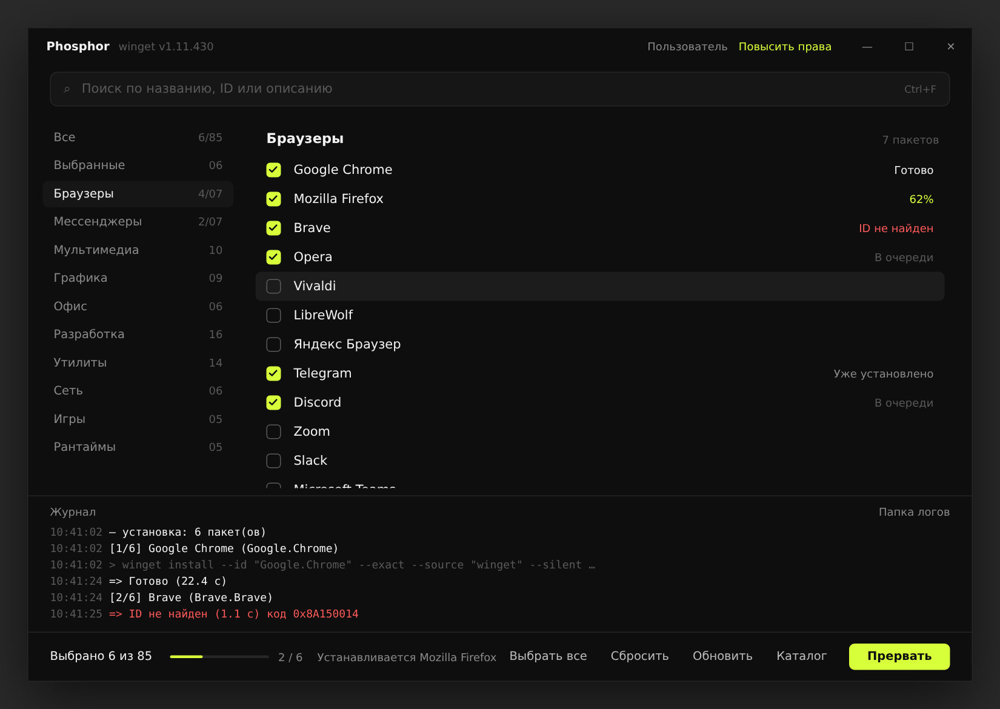

# Phosphor — портативный пакетный установщик на winget

Один `Phosphor.exe` (~200 КБ), без установки и без дополнительных рантаймов: работает на .NET Framework 4.8, который уже есть в Windows 10 (1903+) и Windows 11. Выбираете программы галочками — Phosphor по очереди ставит их через `winget` в тихом режиме.



> Скриншот — превью-макет интерфейса.

## Сборка

Нужен .NET SDK 8 (только на машине, где собираете):

```
winget install Microsoft.DotNet.SDK.8
.\build.cmd        # в PowerShell; в cmd.exe — просто build.cmd
```

Результат — `dist\Phosphor.exe`. Его можно носить на флешке.

Без локальной сборки: каждый push в `main` собирается в GitHub Actions, exe лежит в артефактах прогона.

### Выпуск релиза

```
git tag v1.0.0
git push origin v1.0.0
```

Workflow соберёт exe с версией из тега и опубликует релиз с `Phosphor.exe` и `Phosphor.exe.sha256`.

## Использование

| Клавиша | Действие |
|---|---|
| клик / `Пробел` | отметить пакет (ID и описание — в подсказке при наведении) |
| `F2` | выбрать все видимые (повторно — снять) |
| `F3` | снять всё |
| `F5` | перечитать `apps.json` |
| `F6` | открыть `apps.json` в редакторе |
| `F9` | установить / прервать после текущего пакета |
| `Ctrl+F`, `Esc` | поиск / очистить |

Поиск идёт по имени, winget-id, описанию и категории сразу во всех категориях. Категория **Выбранные** показывает отмеченное и пакеты с результатом последней установки.

Кнопка **Повысить права** перезапускает программу от администратора с сохранением выбора — так UAC спросит один раз, а не для каждого пакета.

Журнал каждой установки пишется в `logs\phosphor-ГГГГММДД-ЧЧММСС.log` рядом с exe (если папка только для чтения — в `%TEMP%\Phosphor\logs`).

### Командная строка

```
Phosphor.exe --select Google.Chrome,7zip.7zip,VideoLAN.VLC
Phosphor.exe --select Google.Chrome,7zip.7zip --install
```

`--select` отмечает только перечисленные id, `--install` запускает установку сразу после старта.

## Каталог `apps.json`

При первом запуске рядом с exe создаётся `apps.json` со встроенным каталогом (85 пакетов, 10 категорий, все id сверены с репозиторием winget-pkgs). Правьте его как угодно и жмите `F5` — пересборка не нужна.

```json
{
  "apps": [
    { "name": "Google Chrome", "id": "Google.Chrome", "category": "Браузеры",
      "description": "Браузер от Google", "selected": true },
    { "name": "WhatsApp", "id": "9NKSQGP7F2NH", "category": "Мессенджеры",
      "source": "msstore" },
    { "name": "VC++ x64", "id": "Microsoft.VCRedist.2015+.x64", "category": "Рантаймы",
      "args": "--scope machine" }
  ]
}
```

| Поле | Обяз. | Описание |
|---|---|---|
| `id` | да | winget id (ищется точно, `--exact`). Найти: `winget search <имя>` |
| `name` | | отображаемое имя (по умолчанию = id) |
| `category` | | категория; порядок категорий = порядок первого появления |
| `description` | | короткое описание |
| `source` | | `winget` (по умолчанию) или `msstore` |
| `args` | | доп. аргументы `winget install`, напр. `--scope machine`, `--version 1.2.3`, `--override "..."` |
| `selected` | | отмечено при запуске |

Если файл сломан или в нём нет ни одного `id`, загрузится встроенный каталог, а причина появится в журнале. Комментарии в JSON не поддерживаются.

## Как ставятся пакеты

```
winget install --id "<id>" --exact --source "<source>" --silent
  --accept-package-agreements --accept-source-agreements --disable-interactivity [args]
```

Пакеты ставятся строго по очереди (параллельно MSI-установщики всё равно не работают). Коды winget переводятся в статусы:

| Статус | Значение |
|---|---|
| Готово / Готово · нужна перезагрузка | установлено |
| Уже установлено / Последняя версия | пакет уже стоит, обновлений нет |
| ID не найден | id нет в источнике — проверьте `winget search` |
| Нет сети, Нет места на диске, Файлы заняты, Запрещено политикой, Отменено | ошибки установщика |
| Ошибка | прочее — точный код `0x…` в журнале |

## Известные нюансы

- **Нужен winget.** На Windows 11 и свежих 10 он есть. Если нет — Phosphor подскажет поставить «Установщик приложений» (App Installer) из Microsoft Store. На LTSC/Server winget ставится вручную.
- **SmartScreen.** exe не подписан, поэтому при первом запуске Windows может показать «Система Windows защитила ваш компьютер» → «Подробнее» → «Выполнить в любом случае».
- **Spotify** отказывается ставиться из-под администратора — запускайте Phosphor без повышения прав, если он нужен.
- **msstore-пакеты** (WhatsApp) требуют работающего Microsoft Store и учётной записи региона, где пакет доступен.
- При запуске от администратора user-scope пакеты (VS Code, Telegram и т.п.) ставятся в профиль того пользователя, от имени которого выполнено повышение.

## Структура

```
build.cmd [версия]            сборка → dist\Phosphor.exe
.github/workflows/build.yml   CI: проверка каталога, сборка, SHA256, релиз по тегу v*
.github/ISSUE_TEMPLATE/       шаблоны: ошибка, запрос пакета в каталог
docs/preview.png              превью интерфейса
src/
  Phosphor.csproj             net48 + WPF
  App.xaml(.cs)               тема (монохром + один акцент) и разбор аргументов
  MainWindow.xaml(.cs)        окно, очередь установки, журнал, горячие клавиши
  Winget.cs                   запуск winget, фильтр вывода (спиннеры, прогресс), коды возврата
  Catalog.cs                  загрузка/создание apps.json, fallback на встроенный каталог
  Models.cs                   модели каталога и строк списка
  apps.default.json           встроенный каталог
```

## Лицензия

[MIT](LICENSE)
